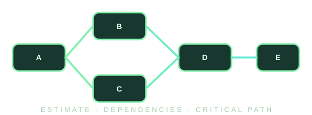

<p align="center">
  
  <br/>
  <br/>   
  <br/>
</p>

## 🧭 Overview

PERT Estimator is a dependency-free Python CLI for three-point task estimates. It calculates expected durations, earliest start/finish times, and one longest dependency path.

## ✨ Features

- 📐 Calculate expected duration with `(optimistic + 4 × likely + pessimistic) / 6`.
- 🔗 Respect task dependencies and topologically order the plan.
- 🧭 Identify one critical path and its approximate variance.
- 🚧 Detect duplicate IDs, unknown dependencies, and dependency cycles.
- 📄 Print a readable table or machine-friendly JSON.

## 🎬 Demo

The included task graph contains parallel and dependent work. Run it to see expected durations and the longest path. No hosted demo is claimed.

## 🚀 Quick Start

Requires Python 3.10 or newer.

```bash
python main.py sample/tasks.json
```

For JSON output:

```bash
python main.py sample/tasks.json --json
```

## 🧰 Tech Stack

- 🐍 Python 3.10+
- 📚 Standard library only
- 📦 No third-party dependencies

## 🗂️ Folder Structure

```text
pert-estimator/
├── assets/mark.svg
├── main.py
├── sample/tasks.json
├── pyproject.toml
├── README.md
├── LICENSE
└── .gitignore
```

## 🛣️ Roadmap

- [ ] Report multiple equally long critical paths.
- [ ] Export a Mermaid dependency diagram.
- [ ] Add CSV task input.

## 🤝 Contributing

Add small sample graphs for parallel work, cycles, and missing dependencies. Keep calculations deterministic and document assumptions.

## 📄 License

MIT licensed. See [LICENSE](LICENSE).

<p align="center"></p>
